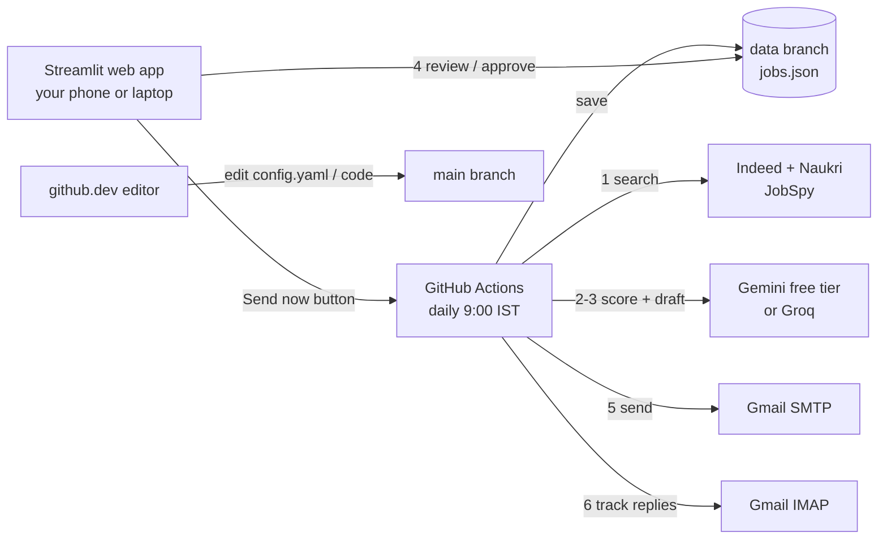

# Job Application Agent

Finds jobs, scores each one against your resume with AI, writes a tailored email,
waits for your approval, sends it from Gmail with your resume attached, and tracks replies.

**Nothing to install on your computer.** No Python, no terminal, no Codespaces.
Everything runs on free cloud services, and none of them keep a "session" that can break.



## Why this setup never "breaks a session"

| Part | Tool | Why it can't lose your work |
|---|---|---|
| Edit code and settings | **github.dev** (press `.` on the repo) | Runs only in your browser. No VM, so there is no idle timeout. Every save is a git commit. |
| Run the agent | **GitHub Actions** | Starts fresh on every run, then shuts down. Nothing stays running, so nothing can time out. |
| Review screen | **Streamlit Community Cloud** | Holds no data. If it sleeps after 12 hours without visitors, click "wake up" and everything is still there. |
| Storage | **`data` branch** in this repo | Every change is a versioned commit. Data commits go to a separate branch, so they never restart the app. |

GitHub Codespaces is **not** used: it stops after 30 minutes idle (4 hours max) and every session is capped at 12 hours.

## The flow

| # | Step | Where | Status after |
|---|---|---|---|
| 1 | Search Indeed + Naukri for every term x location in `config.yaml` | Actions | `new` |
| 2 | Score 0-100 against `profile/resume.md` | Actions + AI | `review` or `low_match` |
| 3 | Draft subject + email | Actions + AI | (draft saved) |
| 4 | You edit, then **Approve**, **I applied on the website**, or **Skip** | Web app | `approved` / `applied_manually` / `rejected` |
| 5 | Send with resume PDF attached (max 15/day) | Actions + Gmail | `sent` or `failed` (Retry button) |
| 6 | Detect replies from the same company domain; flag follow-ups after 7 days | Actions + Gmail | `replied` |

Safety built in: nothing is ever sent without your approval, duplicates are never stored or sent twice,
a daily send limit protects your Gmail, one failing job site never stops the run, and if the AI
quota runs out a keyword matcher takes over so the flow keeps going.

## Setup (about 20 minutes, all in the browser)

See **[docs/SETUP.md](docs/SETUP.md)** for click-by-click steps. Summary:

1. **Resume:** upload `profile/resume.pdf` and paste your resume text into `profile/resume.md`.
2. **AI key:** create a free Gemini key at [aistudio.google.com/apikey](https://aistudio.google.com/apikey).
3. **Gmail:** turn on 2-Step Verification, then create an App Password at [myaccount.google.com/apppasswords](https://myaccount.google.com/apppasswords).
4. **Repo secrets** (Settings -> Secrets and variables -> Actions): `LLM_API_KEY`, `GMAIL_ADDRESS`, `GMAIL_APP_PASSWORD`.
5. **First run:** Actions tab -> *Job agent* -> *Run workflow*.
6. **Web app:** deploy `streamlit_app.py` on [share.streamlit.io](https://share.streamlit.io) and paste the secrets from `.streamlit/secrets.toml.example`.

## Daily use

1. Open your Streamlit app link (works on your phone).
2. Review the drafts, edit if needed, approve the good ones.
3. Press **Send approved now**, or let the next morning run send them.

To change search terms, locations, score threshold or limits: open the repo, press `.`, edit `config.yaml`, commit.

## Project layout

```
config.yaml               your settings (no secrets)
profile/resume.md         resume text the AI reads
profile/resume.pdf        attached to every email (you upload this)
jobagent/search.py        step 1  - JobSpy search, cleaning, de-duplication
jobagent/llm.py           steps 2-3 - AI scoring + email draft, keyword fallback
jobagent/mailer.py        steps 5-6 - Gmail send + reply detection
jobagent/store.py         jobs.json on the data branch, conflict-safe saves
jobagent/pipeline.py      the agent: run | search | score | send | track
streamlit_app.py          step 4  - review screen
.github/workflows/        agent.yml (daily + on demand), tests.yml (on every push)
tests/                    unit tests + full end-to-end flow test
```

## Free limits

| Service | Free allowance | This project uses |
|---|---|---|
| GitHub Actions (private repo) | 2,000 minutes / month | about 3-5 min a day, around 150 min / month |
| Gemini API free tier | rate-limited free models | 25 jobs a day max (`max_jobs_per_run`) |
| Streamlit Community Cloud | 1 private app | 1 app |
| Gmail | normal account limits | 15 emails a day max |

## Notes

- **LinkedIn is not automated** on purpose. Its user agreement bans bots and can restrict your account. Apply there by hand and use **I applied on the website** to track it.
- Many postings don't list an email. For those, type the recruiter's address if you have it, or apply on the site and mark it.
- To switch to Groq instead of Gemini, change `llm.base_url` and `llm.model` in `config.yaml` and put your Groq key in `LLM_API_KEY`.
